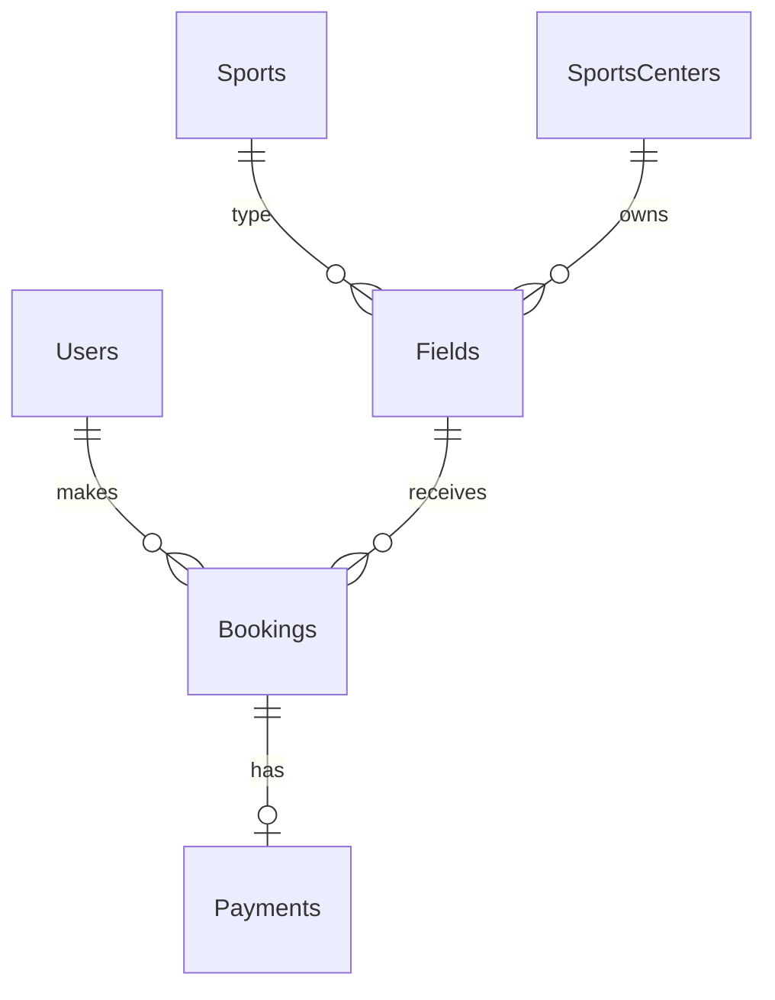

# 4. Backend Schema — данни и ER модел

## Бизнес база `SportsBookingDB_Simple`

| Таблица | Основни полета | Връзки |
|---|---|---|
| `Users` | `UserID` (PK), FullName, Email (UNIQUE), Phone | 1:N с Bookings |
| `Sports` | `SportID` (PK), SportName (UNIQUE) | 1:N с Fields |
| `SportsCenters` | `CenterID` (PK), CenterName, City | 1:N с Fields |
| `Fields` | `FieldID` (PK), FieldName, CenterID (FK), SportID (FK), PricePerHour | 1:N с Bookings |
| `Bookings` | `BookingID` (PK), UserID (FK), FieldID (FK), BookingDate, StartTime, EndTime, Status | 1:0..1 с Payments |
| `Payments` | `PaymentID` (PK), BookingID (FK+UNIQUE), Amount, PaymentMethod | 1:1 към резервация (максимум едно плащане) |

### Кратка ER структура

## Authentication база `SportsBookingIdentityDB`
При първото стартиране EF Core Identity създава `AspNetUsers`, `AspNetRoles`, `AspNetUserRoles`, `AspNetUserClaims`, `AspNetUserLogins`, `AspNetUserTokens`, `AspNetRoleClaims` и свързаните индекси. Използва се втори `DbContext` (`IdentityContext`). `AspNetUsers.BookingUserId` е логическа препратка към `SportsBookingDB_Simple.dbo.Users.UserID`, **не е cross-database FK**.

## Конфигурация
Двете връзки са в `SportsBooking.Web/appsettings.json`. По подразбиране се използва `Server=(localdb)\MSSQLLocalDB`, което изисква SQL Server Express LocalDB на Windows; за SQL Server Express сменете и двете връзки.

## Изходен код
`Data/SportsBookingContext.cs`, `Data/IdentityContext.cs`, `Models/`, `database/SportsBooking_Simple.sql`. Диаграмата е във `docs/ER_Diagram.png`.
